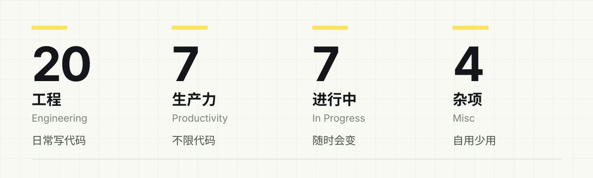
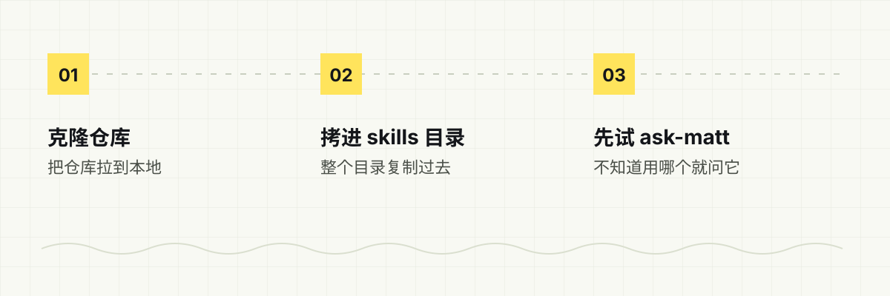
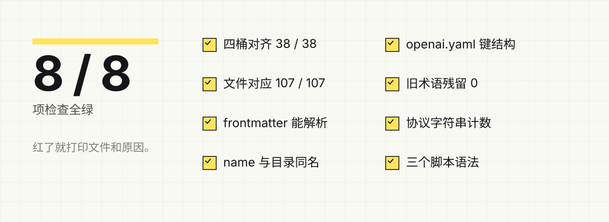
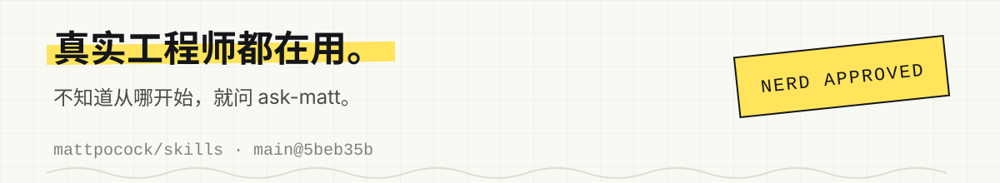

<p align="center">
  
</p>

Matt Pocock 写的一套 agent skills，让 AI 编程智能体按固定流程干活：写 spec、拆 ticket、跑 TDD、审代码、交接会话。这里是它的中文译本，与上游逐文件对齐，中英目录并排放着，方便对照。

## 规模

| 38 | 107 | 0 |
|:--:|:--:|:--:|
| 个 skill | 个文件 | 处漂移 |

## 四个分类

| 分类 | 数量 | 做什么 | 入口 |
| --- | :--: | --- | --- |
| 工程 Engineering | 20 | 日常写代码：需求、spec、ticket、TDD、review、排错 | [中文版本/engineering](中文版本/engineering/README.md) |
| 生产力 Productivity | 7 | 不限于代码的工作流：访谈、交接、教学、写文档 | [中文版本/productivity](中文版本/productivity/README.md) |
| 进行中 In Progress | 7 | beta，随时会变，别急着依赖 | [中文版本/in-progress](中文版本/in-progress/README.md) |
| 杂项 Misc | 4 | 自用但少用的小工具 | [中文版本/misc](中文版本/misc/README.md) |

38 个 skill 的点名录在各桶自己的 README 里，这里不重复 38 行。

<p align="center">
  
</p>

## 第一次来，先试这三个

- **ask-matt**：不知道该用哪个 skill 时问它，它会根据你的场景推荐，不用自己从 38 个里挑。
- **tdd**：红-绿-重构，一次一小步，先写出失败的测试。
- **handoff**：把当前对话整理成一份交接文档，交给另一个智能体接着做。

## 装到本地

中文版不是 npm 包，装法就是「把目录放进去」：

```bash
git clone https://github.com/a-RunShine/matt-pocock-zh.git
```

然后把 `中文版本/<分类>/<skill>` 整个目录拷进你所用智能体的 skills 目录，比如 `中文版本/engineering/tdd`。每个 skill 目录自带它需要的文件，不用挑。

<p align="center">
  
</p>

## 译文怎么保证没跑偏

```bash
python scripts/verify_zh.py
```

一次跑完这些检查：四个桶 38 个 skill 一一对齐、frontmatter 能被解析、`name` 与目录同名、`openai.yaml` 键结构、旧术语残留、协议字符串计数、beta 提示、三个脚本的语法。全绿才算数，红了会打印文件和原因。

<p align="center">
  
</p>

## 目录结构

```text
中文版本/     ← 唯一产出物，四个桶 38 个 skill
英文版本/     ← 上游原文，只读参照，不要手改
docs/         ← wiki 记忆、术语规则、审计结论
scripts/      ← 校验与部署脚本，只读，不改译文
实操/         ← 亲手跑 skill 留下的产物，随时可删
```

## 维护边界

- 上游是 [mattpocock/skills](https://github.com/mattpocock/skills)，基线 `main@5beb35b`（2026-10-19）。版本号落后于 `main`，别拿发布标签当基准。
- 上游更新后：先说清楚改了什么，再同步翻译；只重译有变化的文件，不在旧译文上打补丁。
- 有些地方是有意偏离（比如模板里给人填的标题占位符允许本地化），都记在 `docs/wiki/`，别当成误译修回去。
- 下面这些一律保持英文，因为它们要被程序读：frontmatter 的 `name`、分诊标签、tracker 协议行、脚本输出的 `BLOCKED:`。

## 出处

译文对应上游 [mattpocock/skills](https://github.com/mattpocock/skills)，版权归原作者所有。发现译错或有更顺的说法，欢迎开 issue。

<p align="center">
  
</p>
