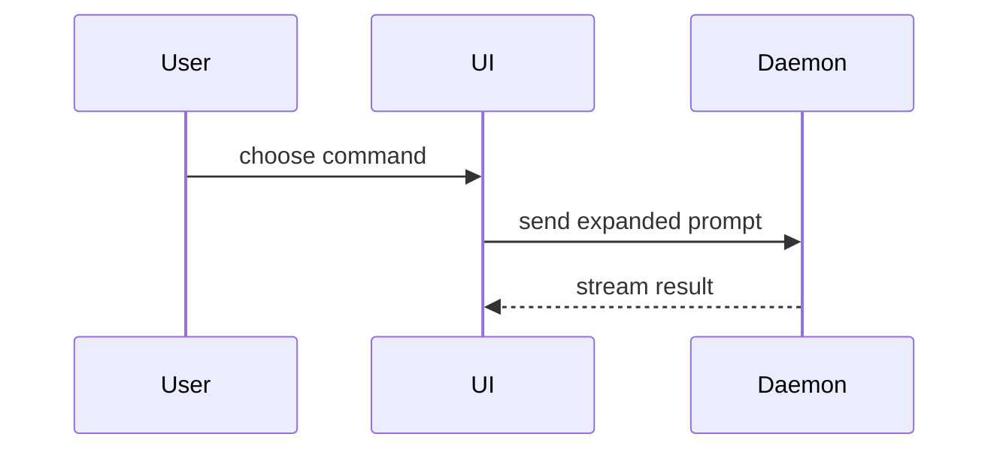

撰写 PR 正文时使用此模板：

```markdown
## Summary

<图示、diff 草图或目录树>

## Evidence

- **Before:** <截图/输出/失败的测试运行>
  **After:** <截图/输出/通过的测试运行>

## Merge Danger

**Door:** <one-way or two-way>

<可选：描述>

**Blast Radius:** <一个词的描述>

<可选：合并可能带来的潜在影响>
```

## 各节说明

跳过所有前言，保持文字简洁。使用 `GLOSSARY.md` 中用户的领域语言。

### Summary

选择能清楚说明关键点的最小视图。

- 以伪代码展示逻辑或算法：

```text
on(save)
  if content is unchanged
    return cached result
  write new content
  return fresh result
```

- 以调用树展示运行时控制流：

```text
submitForm
  createSession
    persistPrompt
    launchAgent
  navigateToSession
```

- 以组件树展示 UI 结构，包括重要的状态和模块边界：

```text
<SessionPage> (apps/example/src/routes/session.tsx)
  useSessionEvents()
  <SessionToolbar>
    <RunSkillButton> (packages/ui)
```

- 以浅层文件树展示文件职责或大范围重构：

```text
src/
├── commands/       # parses user actions
├── sessions/       # owns session state
└── transport/      # sends API requests
```

- 用 Mermaid 展示组件交互、控制流或数据流：



- 当重点在于_哪些地方发生了变化_，且周围结构已经存在时，使用 `diff`。让 diff 的形式与主题相匹配。

对于组件变更：

```diff
 <SessionPage>
   useSessionEvents()
   <SessionToolbar>
+    <RunSkillButton />
   <SessionTimeline>
+    <SkillResultCard />
```

对于文件布局变更：

```diff
 src/
 ├── commands/
+│   └── show-me.ts       # expands the slash command
 ├── sessions/
-└── transport.ts
+└── transport/
+    ├── client.ts
+    └── stream.ts
```

对于调用树或调用栈的变更：

```diff
 submitForm
   createSession
     persistPrompt
+    expandSkillMention
     launchAgent
-  navigateToSession
+  navigateToSession
+    subscribeToEvents
```

对于状态或控制流的变更：

```diff
 on(save)
-  write content
+  if content is unchanged
+    return cached result
+  write new content
+  invalidate cache
```

- 当大部分内容都是新增的、省略的上下文会掩盖归属或顺序、或者用户需要一个可复制的目标形态时，展示完整代码块：

```ts
function expandSkill(command: string): string {
  const skillName = command.slice(1);
  return `use the ${skillName} skill`;
}
```

#### 指导

将每个视觉元素放在其所支持的简短文字旁边。只保留回答用户当前问题、或解决当前讨论点所需的调用、文件、属性、状态和边界。

你可以使用其中一种，也可以使用多种；通常不会全部使用。依据判断，不要让用户负担过重。

### Evidence

证明变更有效的具体证据。展示前后对比。

在环境已经配置好、且变更是视觉性的时候，截图是 S 级证据。

基于执行的证据是 A 级：测试结果、控制台输出。以伪代码展示那个从失败变为通过的具体测试。

### Merge Danger

说明它是单向门还是双向门。双向门可以回退，单向门则不行。成本低的回滚意味着风险较低的 PR。涉及破坏性操作或难以逆转的决定的变更，属于单向门。

影响半径（blast radius）是本 PR 所引入变更的潜在影响范围或波及面。应考虑所有可能性。例如布局偏移、对使用方的破坏、移动端响应式问题等。
